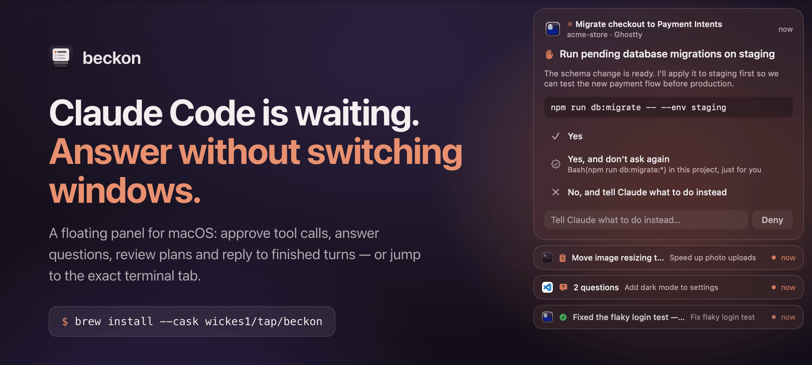
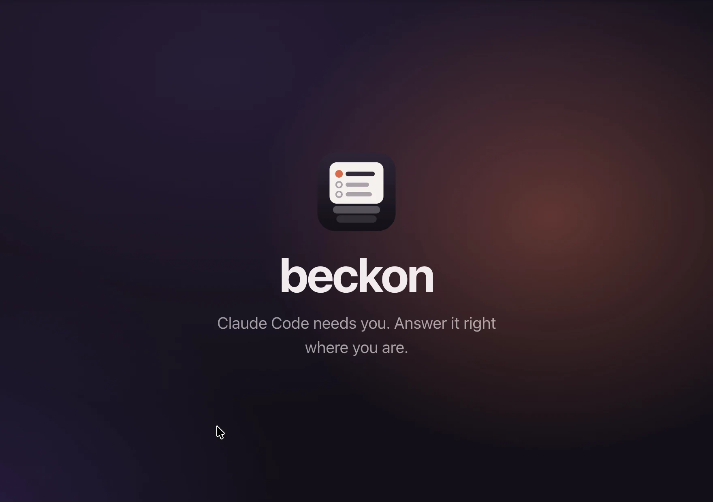
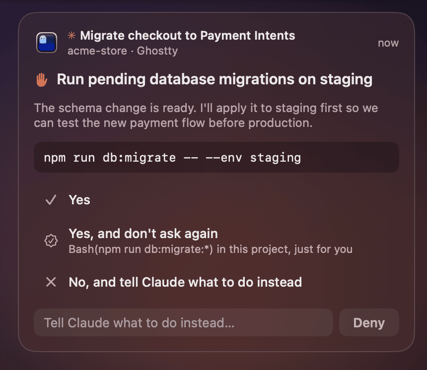
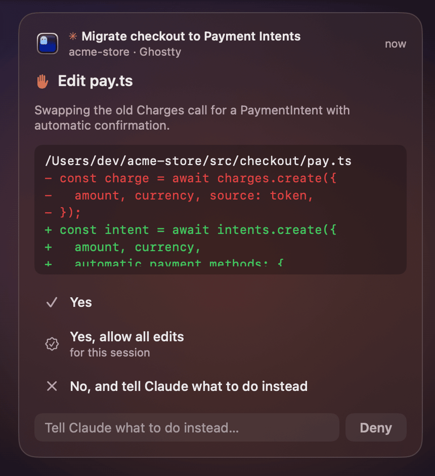
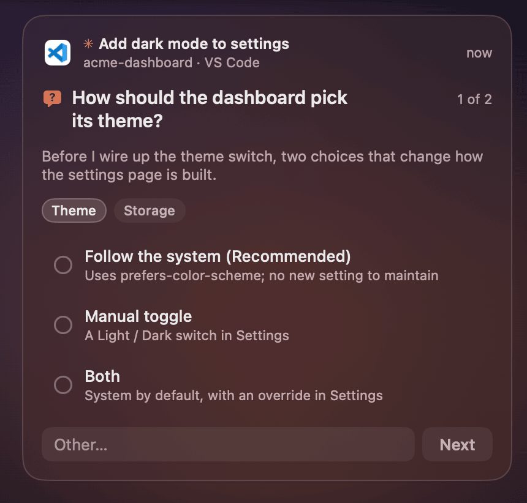
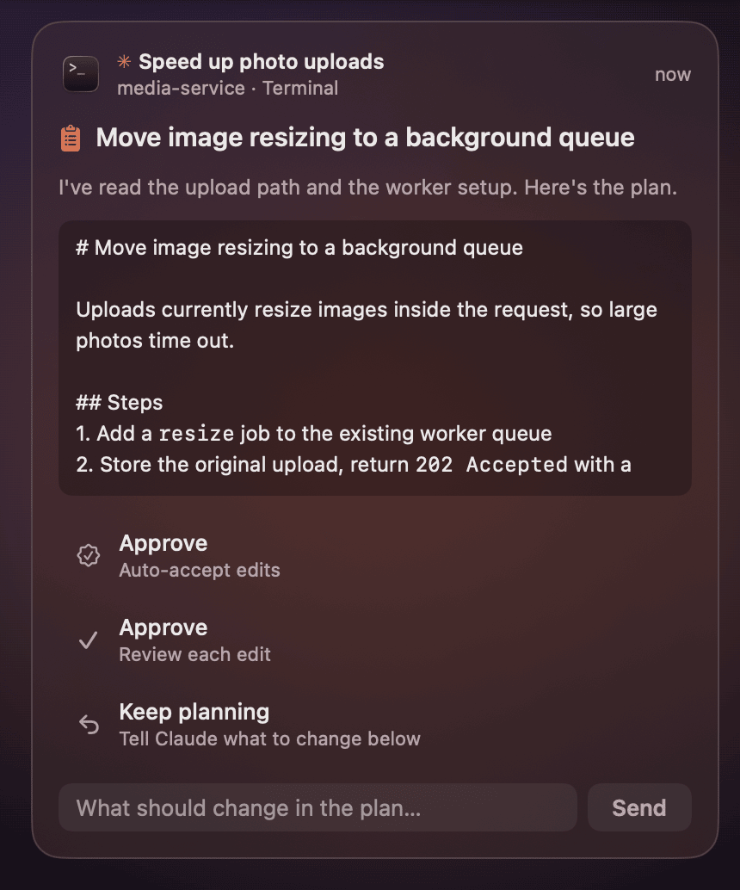
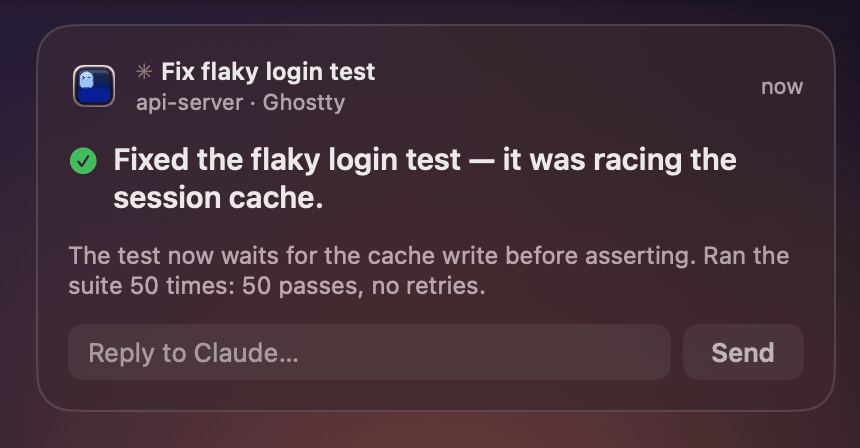
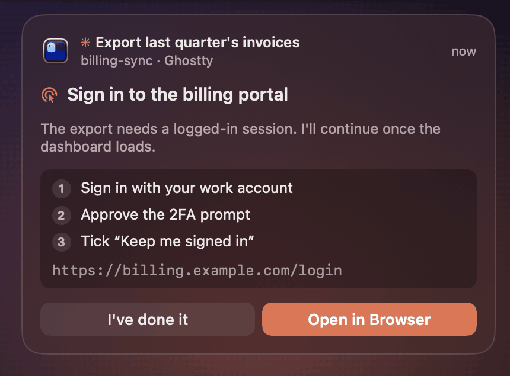

<p align="center"></p>

<p align="center">
  <a href="#install">Install</a> ·
  <a href="#what-appears-on-the-panel">Cards</a> ·
  <a href="#what-works-where">Supported apps</a> ·
  <a href="#commands">Commands</a>
</p>

<p align="center">
  <a href="LICENSE"></a>
  
</p>

A floating panel for Claude Code on macOS. When Claude Code needs you, answer on the card, or click it to land on the exact terminal or browser tab where Claude is waiting.

## Features

- **Answer on the card.** Approve a tool call (or add a "don't ask again" rule), answer AskUserQuestion, approve or revise a plan, reply to a finished turn. The terminal dialog stays live; whichever you answer first wins.
- **Land on the exact place.** Click a card to reach the VS Code window and terminal, the Ghostty tab or the Terminal.app tab where Claude is waiting, even when it is buried under other windows.
- **Get sent where you're needed.** A script or Claude Code skill runs `beckon notify` to point you at a Brave tab or a web page, and `beckon dismiss` once it sees you're done.
- **Stays out of your way.** The panel never takes the keyboard unless you click a field, shows nothing for the session you're already looking at, and lets phone pushes through only while the screen is locked.
- **Safe by default.** Decisions go through Claude Code's own permission system; beckon has no allow rules of its own. If the app isn't running, every hook exits at once and Claude Code behaves as if beckon weren't installed.
- **Light.** The hook costs 2.8 ms at p90 on top of starting a process, 5 ms in all (measured), with no runtime dependencies.

<p align="center"></p>

<p align="center"><sub>Recorded from the real app with made-up sessions. <a href="docs/images/demo.mp4">HD video</a></sub></p>

## What it touches

- **Claude Code hooks.** Eight of them (PermissionRequest, PostToolUse, PostToolUseFailure, UserPromptSubmit, Stop, StopFailure, SubagentStop, SessionEnd), each running `beckon hook <event>`. The plugin adds them; a source install writes them into `~/.claude/settings.json`.
- **No network.** The CLI and the app talk over a Unix socket in `~/Library/Application Support/beckon/`, a directory only your user can open. Nothing is sent anywhere.
- **No stray clicks.** A click answers a card only once the card has been up for 0.5 s and the pointer has been on the panel for 0.3 s.
- **A log of answers.** `~/Library/Logs/beckon.log` gets one line per answer: the time, allow or deny, how long the card was up, the session id and the card's title. A reply you type is logged by length, not by content.
- **Other apps.** To land on an exact tab, beckon asks macOS for permission to control Ghostty, Terminal.app or Brave, the first time you click through to each.
- **Not notarized.** There is no Apple Developer ID behind it; the app is signed with a self-signed certificate and the Homebrew cask checks the download against a sha256.

## Install via your AI agent

Paste this into Claude Code (or another coding agent):

> Install beckon from https://github.com/wickes1/beckon on this Mac. Read https://raw.githubusercontent.com/wickes1/beckon/main/README.md first.
> 1. Run `brew install --cask wickes1/tap/beckon`, then `open -a Beckon`.
> 2. Run `claude plugin marketplace add wickes1/beckon` and `claude plugin install beckon@beckon`.
> 3. For each of the commands `code`, `cursor` and `codium` that exists, run it with `--install-extension /Applications/Beckon.app/Contents/Resources/beckon.vsix`.
> 4. Ask me whether phone pushes should reach me only while the screen is locked. Only if I say yes, add `"CLAUDE_CLIENT_PRESENCE_FILE": "<my home directory>/Library/Application Support/beckon/present"` to the `env` block of `~/.claude/settings.json`, creating the block if it is missing. Change nothing else in the file.
> 5. Run `beckon doctor` and show me the output. No line may start with ✗.
> 6. Run `beckon test`, tell me a sample card is at the top right of my screen, and tell me to restart every Claude Code session, this one included.
>
> Stop and ask me if anything is ambiguous; do not guess.

## Install

Needs macOS 14 or later and Claude Code 2.1.287 or later: the hooks pass their arguments as `args` (added in 2.1.139), the phone-push setting is `CLAUDE_CLIENT_PRESENCE_FILE` (added in 2.1.181), and 2.1.287 fixed a background (`asyncRewake`) hook waking Claude again and again when its command is missing.

### Homebrew

```sh
brew install --cask wickes1/tap/beckon
open -a Beckon
claude plugin marketplace add wickes1/beckon
claude plugin install beckon@beckon
beckon doctor
```

The app has no window: its icon is in the menu bar, possibly in the hidden section of a menu-bar manager. `beckon test` puts a sample card at the top right of the screen.

Then restart the Claude Code sessions that were already running, ask for something that needs permission, and switch to another app: the card arrives within seconds. While that session's terminal is in front there is no card, only a count beside the menu bar icon.

| Also | How |
|---|---|
| Start with the Mac | menu bar icon → Open at Login |
| Exact VS Code window and terminal | install the beckon extension: [VS Code Marketplace](https://marketplace.visualstudio.com/items?itemName=wickend.beckon), [Open VSX](https://open-vsx.org/extension/wickend/beckon) for Cursor and VSCodium, or `code --install-extension /Applications/Beckon.app/Contents/Resources/beckon.vsix`. Without it a click only brings VS Code forward, and a prompt is held back whenever VS Code is in front. VS Code keeps extensions per profile, so install it in each profile you use |
| Phone pushes only while the screen is locked | the `env` line `beckon doctor` prints (see "Phone pushes") |
| After `brew upgrade` | `open -a Beckon` (an upgrade quits the app), then `claude plugin update beckon@beckon` and restart the Claude Code sessions, so the hooks match the new CLI |

Beckon.app is self-signed, not notarized. The cask clears the download quarantine flag after installing; without that, Gatekeeper refuses the app. A zip downloaded by hand from the releases page stays blocked, so install through Homebrew or from source.

### From source

Needs a Swift 6 toolchain (Xcode 16 or later, or its Command Line Tools) and `jq`.

```sh
git clone https://github.com/wickes1/beckon && cd beckon
scripts/install.sh
```

`scripts/install.sh` creates a self-signed signing identity (`beckon Dev`), builds and installs `~/Applications/Beckon.app`, links `~/.local/bin/beckon`, merges the hooks and the presence line into `~/.claude/settings.json` (a backup is written next to it), installs the VS Code extension if `code` is on PATH, and runs `beckon doctor`. Its first step, `scripts/make-signing-cert.sh`, adds that certificate to your login keychain and marks it trusted for code signing; macOS asks for your login password to allow it. This route writes the hooks itself: do not add the plugin on top, or every prompt arrives twice.

### Permissions macOS will ask for

The first time you click through to Ghostty, Terminal.app or Brave, macOS asks whether beckon may control that app. Until you allow it, beckon can only bring the app forward and assumes you're looking at the session whenever that app is in front.

If you answered Don't Allow, macOS does not ask again and `beckon doctor` shows that app as `denied`. Turn it on under System Settings → Privacy & Security → Automation → beckon, or run `tccutil reset AppleEvents dev.wickend.beckon` to be asked again at the next click.

### No card?

- `beckon doctor` names what is wrong on each line that starts with ✗. Lines that start with · are notes.
- The app isn't running, which is also the state after `brew upgrade`: `open -a Beckon`.
- The session was started before the install: restart it.
- You are looking at that session's terminal: the prompt is held back on purpose and counted beside the menu bar icon.
- VS Code without the extension: a prompt is held back whenever VS Code is in front.

### Uninstall

| Installed with | Remove with |
|---|---|
| Homebrew | first `claude plugin uninstall beckon@beckon` and `claude plugin marketplace remove beckon`, then `brew uninstall --zap --cask beckon`, and the `CLAUDE_CLIENT_PRESENCE_FILE` line if you added it. The plugin goes first: left installed without the CLI, its hooks fail to start on every event |
| Source | `scripts/hooks.sh uninstall`, then `pkill -x BeckonApp; rm -rf ~/Applications/Beckon.app ~/.local/bin/beckon ~/Library/Application\ Support/beckon ~/Library/Logs/beckon.log ~/Library/Preferences/dev.wickend.beckon.plist` |
| VS Code extension | `code --uninstall-extension wickend.beckon` |

Before either route, turn off menu bar icon → Open at Login if you had turned it on: nothing above does. With the app already gone, look for a leftover beckon entry under System Settings → General → Login Items.

What stays after either route:

- the Automation grants; `tccutil reset AppleEvents dev.wickend.beckon` clears them
- `~/Library/Application Support/beckon/vscode/`, which every VS Code window makes again for as long as the extension is installed: uninstall the extension, then delete `~/Library/Application Support/beckon`
- for a source install, the `beckon Dev` certificate in the login keychain and the `~/.claude/settings.json.beckon-backup-*` files

## What works where

Cards appear, and can be answered, for a session in any terminal. What differs by app is how precisely a click lands. Seen working on one Mac (macOS 26, Claude Code 2.1.322).

| Surface | A click lands on |
|---|---|
| VS Code integrated terminal, Claude Code side panel | the exact window and terminal (needs the extension) |
| Ghostty | the exact tab |
| Brave | the exact tab, for `beckon notify --brave-tab` |
| A web page, for `beckon notify --url` | the page in the default browser. Only `http` and `https` URLs are accepted |
| Terminal.app | the exact tab — written, not yet run |
| Cursor, VSCodium, VS Code Insiders | the exact window and terminal, as VS Code (needs the extension) — written, not yet run |
| Any other terminal (iTerm2, Warp, kitty, WezTerm, …) | the app, brought forward, not the tab — written, not yet run. A card for a session there is also held back whenever that app is in front, whichever tab you are on |
| Other browsers | no exact tab; `--url` opens a page in the default one |

## What appears on the panel

| Card | When | What you do |
|---|---|---|
| Approval | Claude Code asks permission for a tool call | `Yes`, `Yes, and don't ask again …`, or `Deny`, with or without typing what Claude should do instead |
| Question | Claude calls AskUserQuestion | pick per question (or type your own); the last single-select pick sends, typed or multi-select answers use `Send` |
| Plan review | Claude leaves plan mode | approve (auto-accept edits, or review each edit), or type what to change |
| Action needed | a skill ran `beckon notify` | follow the steps; `Open in Brave` jumps to the exact tab, `Open in Browser` opens the URL |
| Done | a turn you started has ended | click the card to go to that session (the card goes away), or type a reply to wake the idle session |
| Stopped | a turn ended on an API error | read the error; click the card to go to the session |

<table>
  <tr>
    <td width="50%" valign="top"></td>
    <td width="50%" valign="top"></td>
  </tr>
  <tr>
    <td align="center"><sub>Approval: a command</sub></td>
    <td align="center"><sub>Approval: an edit, with its diff</sub></td>
  </tr>
  <tr>
    <td valign="top"></td>
    <td valign="top"></td>
  </tr>
  <tr>
    <td align="center"><sub>Question</sub></td>
    <td align="center"><sub>Plan review</sub></td>
  </tr>
  <tr>
    <td valign="top"></td>
    <td valign="top"></td>
  </tr>
  <tr>
    <td align="center"><sub>Done, with a reply field</sub></td>
    <td align="center"><sub>Action needed, from <code>beckon notify</code></sub></td>
  </tr>
</table>

Rules:

- The terminal dialog stays live. Whichever is answered first wins; the other clears itself.
- No card while you are looking at that session's terminal. A prompt held back this way is still counted in the menu bar (the number beside the icon) and appears when you look away; a Done or Stopped card for a session you are watching is dropped. An "Action needed" card always shows, since it sends you somewhere else.
- A card makes a sound when it comes onto the panel: Glass when Claude is waiting on you, Tink for Done / Stopped. Menu bar icon → Sounds picks another system sound or None for each, or mutes both.
- A card can leave by itself. Menu bar icon → Dismiss Cards sets how long each card stays in view: 10 s, 30 s, 60 s or 5 min. Never, the default, keeps every card until you deal with it. A line along the card's bottom edge shrinks as the time runs out, and at the end the card fades away. Point at a card and its countdown is off for good. When the time is up, a Done or Stopped card is dismissed; a prompt or an "Action needed" card is only hidden, so Claude or the skill keeps waiting and the item stays in the menu bar list. Nothing leaves while the pointer is on the panel or an answer is being typed.
- The × on a prompt card only hides it: Claude keeps waiting in the terminal and the item stays in the menu bar list.
- Clicking the top of any card (its header and title) takes you to that session, and every card of that session leaves the panel: a Done or Stopped card goes away, a prompt is hidden as with ×. Another session's cards, and a skill's other "Action needed" cards, stay.
- Only one copy of the app runs at a time; a second one quits at once instead of taking over the socket.
- The panel never takes the keyboard unless you click one of its text fields, and hands it back when you send.
- Every answer given in the panel is logged to `~/Library/Logs/beckon.log`.
- If the app isn't running, every hook exits at once and Claude Code behaves as if beckon weren't installed.
- Headless runs (`claude -p`, the SDK) are ignored.

## Commands

```sh
beckon doctor
beckon test
beckon notify --title "Log in to Example Bank" --step "Sign in" --step "Tick “Remember this device”" --brave-tab 1234567 --key bank-login
beckon dismiss --key bank-login
```

| Command | Flags | Does |
|---|---|---|
| `beckon doctor` | | checks the app, its signature, the hooks, the presence file, VS Code windows and Automation permissions; exits 1 if a check fails |
| `beckon test` | | puts a sample card on the panel, wherever you are looking; exits 1 if the app isn't running |
| `beckon notify` | `--title <text>` (required), `--message <text>`, `--step <text>` (repeatable), `--brave-tab <id>` or `--url <http or https url>`, `--key <name>` | shows an "Action needed" card for the current session; exits 1 if the app isn't running, so the caller can fall back |
| `beckon dismiss` | `--key <name>` (required) | takes that card down |
| `beckon hook <Event>` | `--rewake` (Stop only) | run by Claude Code's hooks; reads the hook JSON on stdin and always exits 0 when the app can't be reached |
| `beckon --version` | | prints the version |

A command line beckon can't read prints the usage and exits 1. Never 2: from a hook, Claude Code would take that as an order to block the prompt.

`notify` is for skills that need you to do something outside the terminal. It returns at once; the skill keeps watching for the result itself and calls `dismiss` when it sees it. `--brave-tab` takes the tab id the claude-in-chrome tools report.

## Phone pushes

beckon keeps a presence file in place while the screen is unlocked and removes it on lock. Point Claude Code at it with `CLAUDE_CLIENT_PRESENCE_FILE` in the `env` block of `~/.claude/settings.json` (`scripts/hooks.sh install` writes it; a plugin cannot, so after a Homebrew install `beckon doctor` prints the line to add) and Claude Code's Remote Control pushes reach your phone only when you can't see the panel.

## Layout

- `Sources/beckon` — the hook CLI. Darwin only, no Foundation; forwards the hook JSON plus process ancestry and terminal env vars to the app, prints the decision, fails open on any error.
- `Sources/BeckonApp` — menu-bar agent: socket server, intake of hook events, store, panel, focus, presence, doctor.
- `Sources/BeckonCore` — paths and version shared by both.
- `vscode/` — the VS Code extension (plain JavaScript, one file). The build packs it into `Beckon.app/Contents/Resources/beckon.vsix`.
- `plugin/` + `.claude-plugin/marketplace.json` — the same hooks as a Claude Code plugin, for installs where `beckon` is on PATH.
- `packaging/beckon.rb.in` — Homebrew cask template.
- `prototype/panel.swift` — the look-and-feel prototype the panel was designed in.
- `Resources/AppIcon.svg` — the icon. `Resources/AppIcon.icns` is generated from it (`rsvg-convert` at each iconset size, then `iconutil -c icns`) and committed, so a build needs neither tool.
- `docs/images/` — README screenshots and demo, taken from the real app fed made-up hook events.

## Development

```sh
scripts/test.sh                     # unit tests (Swift Testing; works with Command Line Tools only)
scripts/build-app.sh --install      # rebuild, re-sign, replace the installed app, relaunch
scripts/hooks.sh print hooks.json   # hooks-only settings file: claude --setting-sources project,local --settings hooks.json
scripts/build-vscode.sh --install   # repack and reinstall the extension
scripts/release.sh                  # universal build → dist/Beckon-<version>.zip + dist/beckon.rb
```

The version is written in `Sources/BeckonCore/Paths.swift`, `vscode/package.json` and `plugin/.claude-plugin/plugin.json`; the build and release scripts stop on a mismatch. `plugin/hooks/hooks.json` must list the same hooks as `scripts/hooks.sh`. Release steps: [docs/releasing.md](docs/releasing.md).

Never run an ad-hoc-signed build: macOS ties permission grants to the signing identity and remembers a refusal per bundle ID.
