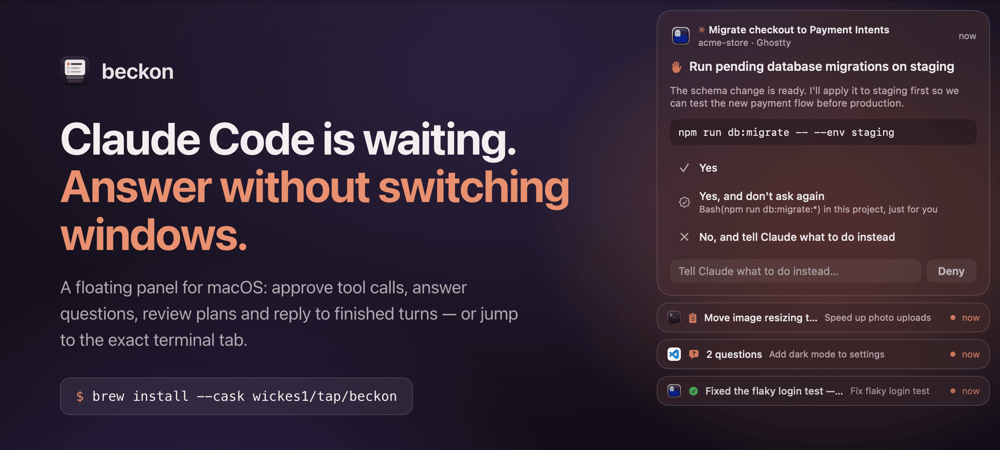

# beckon for VS Code

Companion to [beckon](https://github.com/wickes1/beckon), a floating panel for Claude Code on macOS. It does nothing by itself: install the beckon app first, with `brew install --cask wickes1/tap/beckon`.

| | Without the extension | With it |
|---|---|---|
| Clicking a card | brings VS Code forward | lands on the exact window and integrated terminal, or the Claude Code side panel |
| A prompt from the session you are looking at | held back whenever VS Code is in front | held back only while that terminal is the one in front |

Written for VS Code and the forks on the same extension API (Cursor, VSCodium, VS Code Insiders); so far it has been run in VS Code only. VS Code keeps extensions per profile, so install it in each profile you use.

It opens a Unix socket for the beckon app in `~/Library/Application Support/beckon/vscode/`. macOS only; no settings, no commands, no network.
